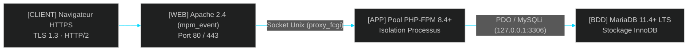

<!-- MASTER-HEADER-START -->
<div align="center">

<a href="https://0xcyberlitech.com/">
  
</a>

<p align="center">
  <a href="https://0xcyberlitech.com/"></a>
  <a href="https://0xcyberlitech.com/soc-rd.html"></a>
  <a href="https://0xcyberlitech.com/jarvis-rd.html"></a>
  <a href="https://github.com/0xCyberLiTech?tab=repositories"></a>
</p>
<p align="center">
  <a href="README.md"></a>
</p>


</div>
<!-- MASTER-HEADER-END -->

<!-- DEBIAN-TRUTH-START -->
> [!IMPORTANT]
>  ** Matrice Officielle Debian — `Debian 12 (Bookworm)` · `Debian 13 (Trixie)` · `Debian 14 (Forky)`**
> - **Sources Officielles Debian.org (`apache2`) :** `Bookworm (12)` : **`2.4.68-1~deb12u1`** &nbsp;·&nbsp; `Trixie (13 — Stable)` : **`2.4.68-1~deb13u1`** &nbsp;·&nbsp; `Forky (14 — Next-Gen)` : **`2.4.69-1`**
> - **Références Officielles :** [Paquet Debian Trixie (`apache2`)](https://packages.debian.org/trixie/apache2) &nbsp;·&nbsp; [Paquet Debian Forky (`apache2`)](https://packages.debian.org/forky/apache2) &nbsp;·&nbsp; [Documentation Officielle Debian](https://packages.debian.org/trixie/apache2)
> - **Note d'Ingénierie (Divergence 13 vs 14) :** Sous Debian 13 (Trixie), PHP passe en version 8.4 (`php8.4-fpm`). Sous Debian 14 (Forky), privilégiez le mode `proxy_fcgi` (`php-fpm`) avec HTTP/2 natif plutôt que le module monolithique `mod_php`.

<details>
<summary> <b>Afficher les Encarts Ligne de Commande : Debian 13 (Trixie — Stable) vs Debian 14 (Forky — Next-Gen)</b></summary>

####  Profil Production Stable — Commandes pour `Debian 13 (Trixie)`
```bash
sudo apt update && sudo apt install -y apache2 libapache2-mod-php8.4 php8.4-fpm
sudo a2enmod ssl rewrite headers http2 && sudo systemctl restart apache2
```

####  Profil Anticipation Next-Gen — Commandes pour `Debian 14 (Forky)`
```bash
# Debian 14 (Forky) — Solveur APT 3.0 & metapaquets PHP independants de la sous-version :
sudo apt update && sudo apt install -y apache2 php-fpm libapache2-mod-fcgid
sudo a2enmod proxy_fcgi setenvif ssl http2 && sudo a2enconf php*-fpm && sudo systemctl reload apache2
```

</details>
<!-- DEBIAN-TRUTH-END -->

<!-- CIEL-PEDAGOGY-START -->
<details>
<summary> <b>Synthèse d'Architecture, Standards Officiels &amp; Diagnostic (Niveau 1 : Fondamentaux · Niveau 2 : Repères · Niveau 3 : Diagnostic)</b></summary>

- **Niveau 1 — Fondamentaux &amp; Principe d'Architecture :** **Apache HTTP Server (`apache2`)** est le serveur Web modulaire de référence sous Debian : il assure la terminaison TLS 1.3, le routage multi-domaines par **VirtualHosts** (`ServerName`) et délègue l'exécution dynamique PHP au gestionnaire de processus `php-fpm`.
- **Niveau 2 — Repères Officiels (Ports IANA, Fichiers Debian &amp; Commandes de Validation) :** **Ports IANA :** `TCP 80` (HTTP) · `TCP 443` (HTTPS TLS 1.2/1.3) &nbsp;|&nbsp; **Arborescence Debian :** `/etc/apache2/sites-available/`, `/etc/apache2/conf-available/` &nbsp;|&nbsp; **Validation officielle :** `sudo apache2ctl configtest` (`Syntax OK`).
- **Niveau 3 — Diagnostic d'Incidents &amp; Ingénierie Avancée :** **Diagnostic & Architecture :** Tout nouveau site déclaré dans `sites-available/` doit être activé via `sudo a2ensite` avant rechargement (`sudo systemctl reload apache2`). En production, associez le moteur asynchrone **MPM `event`** au démon **`php-fpm`** (via `proxy_fcgi`) plutôt qu'à l'ancien module `mod_php` afin d'activer HTTP/2 et de réduire l'empreinte mémoire.
- **Sources de Vérité Officielles Éditeurs &amp; Standards :** [Documentation Officielle Apache HTTP Server 2.4](https://httpd.apache.org/docs/2.4/fr/) &nbsp;·&nbsp; [Wiki Officiel Debian Apache](https://wiki.debian.org/Apache)

</details>
<!-- CIEL-PEDAGOGY-END -->


#  Déploiement Complet d'un Serveur LAMP (Linux Debian 13/14, Apache2, MariaDB & PHP-FPM)

##  01 // PRÉSENTATION & ARCHITECTURE DE LA STACK LAMP MODERNE


La stack **LAMP** (**L**inux · **A**pache2 · **M**ariaDB · **P**HP) constitue le socle historique et industriel de l'hébergement d'applications Web dynamiques et d'outils de supervision (GLPI, Nextcloud, Zabbix Frontend, WordPress).

Sous **Debian 13 (Trixie — Stable)** et **Debian 14 (Forky — Next-Gen)**, l'architecture LAMP évolue vers un modèle **haute performance et isolé** :
- **Système d'exploitation :** `Debian 13 (Trixie)` ou `Debian 14 (Forky)` avec gestionnaire de services `systemd` et pare-feu noyau `nftables`.
- **Serveur HTTP :** **Apache 2.4 (`mpm_event`)** avec support natif **HTTP/2** et **TLS 1.3**.
- **Moteur d'exécution PHP :** **PHP-FPM (`php8.4-fpm` / `php-fpm`)** couplé via socket Unix (`proxy_fcgi`), remplaçant l'ancien module monolithique `libapache2-mod-php` pour isoler les processus et réduire l'empreinte RAM.
- **Base de données relationnelle :** **MariaDB Server (`11.4+ LTS`)** avec authentification locale `unix_socket`.



---

##  02 // INSTALLATION DES COMPOSANTS SOUS DEBIAN 13 (TRIXIE) & DEBIAN 14 (FORKY)


###  A. Mise à jour du système et installation des paquets officiels

Utilisez les métapaquets Debian (`php-fpm`, `php-mysql`, `mariadb-server`) afin de garantir la compatibilité immédiate sur **Debian 13 (Trixie — PHP 8.4)** comme sur **Debian 14 (Forky)** :

<!-- CODE-WINDOW-START -->
> [!CAUTION]
> 
>
> ```bash
> sudo apt update && sudo apt full-upgrade -y
> sudo apt install -y apache2 mariadb-server php-fpm php-mysql php-cli php-curl php-gd php-mbstring php-xml php-zip libapache2-mod-fcgid
> ```
<!-- CODE-WINDOW-END -->

###  B. Activation du moteur moderne `mpm_event` et de `proxy_fcgi` (PHP-FPM)

Pour bénéficier du protocole **HTTP/2** et d'une gestion asynchrone des connexions, basculez Apache2 sur `mpm_event` et reliez-le au démon `php-fpm` :

<!-- CODE-WINDOW-START -->
> [!CAUTION]
> 
>
> ```bash
> # Désactivation éventuelle de mpm_prefork et activation de mpm_event + proxy_fcgi + http2
> sudo a2dismod php* mpm_prefork 2>/dev/null || true
> sudo a2enmod mpm_event proxy_fcgi setenvif rewrite headers ssl http2
>
> # Activation automatique de la configuration PHP-FPM installée (8.4 sous Trixie / Forky)
> sudo a2enconf php*-fpm
> sudo systemctl restart php*-fpm apache2
> ```
<!-- CODE-WINDOW-END -->

---

##  03 // DURCISSEMENT & INITIALISATION DE MARIADB SERVER


###  A. Vérification du service et sécurisation initiale

Sous Debian 13 (Trixie) et Debian 14 (Forky), le compte `root@localhost` de MariaDB utilise par défaut l'authentification système **`unix_socket`** (seul l'administrateur `sudo` local peut s'y connecter sans mot de passe réseau) :

<!-- CODE-WINDOW-START -->
> [!CAUTION]
> 
>
> ```bash
> sudo systemctl enable --now mariadb
> sudo mariadb-secure-installation
> ```
<!-- CODE-WINDOW-END -->

###  B. Création d'une base de données et d'un utilisateur applicatif dédié (Moindre Privilège)

Ne connectez jamais une application Web avec le compte `root`. Créez une base et un utilisateur restreints à `localhost` :

<!-- CODE-WINDOW-START -->
> [!CAUTION]
> 
>
> ```sql
> CREATE DATABASE app_production CHARACTER SET utf8mb4 COLLATE utf8mb4_unicode_ci;
> CREATE USER 'app_user'@'localhost' IDENTIFIED BY 'MotDePasseRobuste_2026!';
> GRANT ALL PRIVILEGES ON app_production.* TO 'app_user'@'localhost';
> FLUSH PRIVILEGES;
> ```
<!-- CODE-WINDOW-END -->

---

##  04 // CRÉATION D'UN VIRTUALHOST APACHE2 DÉDIÉ & SÉCURISÉ


Créez le répertoire de votre application et son fichier d'hôte virtuel `/etc/apache2/sites-available/lamp-app.conf` :

<!-- CODE-WINDOW-START -->
> [!CAUTION]
> 
>
> ```bash
> sudo mkdir -p /var/www/lamp-app/public
> sudo chown -R www-data:www-data /var/www/lamp-app
> sudo chmod -R 750 /var/www/lamp-app
> ```
<!-- CODE-WINDOW-END -->

Configuration du VirtualHost `/etc/apache2/sites-available/lamp-app.conf` :

<!-- CODE-WINDOW-START -->
> [!CAUTION]
> 
>
> ```apache
> <VirtualHost *:80>
>     ServerName lamp.lab.local
>     DocumentRoot /var/www/lamp-app/public
>
>     <Directory /var/www/lamp-app/public>
>         Options -Indexes +FollowSymLinks
>         AllowOverride All
>         Require all granted
>     </Directory>
>
>     # En-têtes de sécurité HTTP
>     Header always set X-Content-Type-Options "nosniff"
>     Header always set X-Frame-Options "SAMEORIGIN"
>     Header always set Referrer-Policy "strict-origin-when-cross-origin"
>
>     ErrorLog ${APACHE_LOG_DIR}/lamp_app_error.log
>     CustomLog ${APACHE_LOG_DIR}/lamp_app_access.log combined
> </VirtualHost>
> ```
<!-- CODE-WINDOW-END -->

Activez le site et vérifiez la syntaxe Apache2 avant rechargement :

<!-- CODE-WINDOW-START -->
> [!CAUTION]
> 
>
> ```bash
> sudo a2dissite 000-default.conf
> sudo a2ensite lamp-app.conf
> sudo apache2ctl configtest
> sudo systemctl reload apache2
> ```
<!-- CODE-WINDOW-END -->

---

##  05 // CONTRÔLE DE FONCTIONNEMENT & JOURNAUX SYSTEMD


Vérifiez que les trois briques (`apache2`, `php-fpm`, `mariadb`) sont actives et écoutez les journaux via `journalctl` :

<!-- CODE-WINDOW-START -->
> [!CAUTION]
> 
>
> ```bash
> sudo systemctl status apache2 mariadb php*-fpm --no-pager
> ss -tulpn | grep -E '80|443|3306'
> sudo journalctl -u apache2 -u mariadb -n 30 --no-hostname
> ```
<!-- CODE-WINDOW-END -->

<!-- MASTER-FOOTER-START -->
<div align="center">


<a href="https://0xcyberlitech.com/">
  
</a>

<p align="center"><a href="https://0xcyberlitech.com/"></a></p>

<sub><b>Architecturé &amp; Forgé par Marc &amp; Antigravity (Google DeepMind)</b> &nbsp;·&nbsp; <a href="https://0xcyberlitech.com/"><b>0xcyberlitech.com</b></a> &nbsp;·&nbsp; <a href="https://0xcyberlitech.com/soc-rd.html">Architecture SOC Cockpit v5.5</a> &nbsp;·&nbsp; <a href="https://0xcyberlitech.com/jarvis-rd.html">Architecture JARVIS Mark-VII</a> &nbsp;·&nbsp; <a href="https://0xcyberlitech.com/blueprint-jarvis.html">Blueprint Matériel RTX 5080</a></sub>

</div>
<!-- MASTER-FOOTER-END -->
